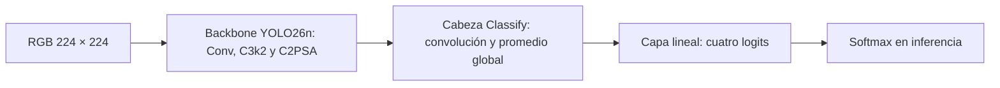

# Justificación y verificación de YOLO26n-cls

## Modelo que se evalúa

Se seleccionó **Ultralytics YOLO26n-cls**, variante nano de clasificación de imágenes.
Cada imagen recibe cuatro puntuaciones, una por clase: Cyst, Normal, Stone y Tumor.
El modelo usa el backbone de YOLO26 y la cabeza estándar `Classify` de Ultralytics.
La configuración del proyecto fija **`ultralytics==8.4.0`** para poder reproducir
la prueba ejecutada. **YOLO26n-cls es el modelo y 8.4.0 es la versión del paquete.**
El nombre `yolo26n-cls.yaml` indica construcción desde la arquitectura. El archivo
`yolo26n-cls.pt` que ofrece Ultralytics corresponde a pesos preentrenados en ImageNet.
El experimento inicializa tanto la CNN como YOLO con pesos aleatorios. [2]–[4]

El código de la versión fijada muestra que `Classify` devuelve logits durante
entrenamiento y probabilidades durante inferencia. La implementación conserva esa
cabeza, configura `nc=4` y usa entropía cruzada sobre logits. Ambos modelos comparten
aumentos, lotes, partición y criterio de selección. El bucle usa Adam para ambos,
una decisión experimental propia. [3], [4]

## Qué demuestra cada fuente

| Fuente | Afirmación que respalda |
| --- | --- |
| Redmon et al., CVPR 2016 [1] | El YOLO original formuló la detección en un solo paso. Es el antecedente de la familia. |
| Jocher et al., arXiv 2026 [2] | El preprint de los desarrolladores describe YOLO26. En «Image Classification» dice que estas variantes reutilizan la cabeza estándar `Classify`. El suplemento S1 evalúa clasificación en ImageNet. |
| Documentación de clasificación [3] | La tarea produce una etiqueta global y su confianza. La variante `-cls` y los pesos ImageNet están documentados explícitamente. |
| YAML y código de la cabeza, etiqueta `v8.4.0` [4] | La arquitectura ejecutada tiene un backbone que termina en C2PSA y usa una cabeza `Classify`. Esto se puede inspeccionar en una versión concreta. |
| Pande y Agarwal, IEEE Access 2024 [5] | Antecedente directo que reporta YOLOv8n-cls en imágenes renales. Describe 12.446 imágenes del conjunto original y una división 80/20. La Fig. 3 incluye fondo y el artículo usa terminología de detección y clasificación. Su protocolo difiere del experimento actual. |
| Islam et al., Scientific Reports 2022 [6] | Describe el conjunto de TC renal de Dhaka y evalúa CNN de transferencia y Vision Transformers. Ese conjunto es una fuente declarada dentro de la recopilación de GonzaJL [7]. |

### Límites de las afirmaciones

- El mAP de COCO, la supresión de cajas y las cifras de latencia ONNX del preprint
  corresponden a otros protocolos. Aquí se mide F1 macro en cuatro clases y latencia
  con el mismo protocolo de inferencia para ambos modelos.
- La comparación de clasificación en el suplemento S1 usa ImageNet y contrasta
  optimizadores. Este estudio usa Adam en ambas redes e imágenes de la versión 2 de
  GonzaJL. Las métricas renales se calcularon con las diez corridas propias, conservadas en `results/full/`.
- La compilación de GonzaJL combina cuatro fuentes. En la auditoría local se
  confirmaron 11.756 imágenes originales y 10.531 tras quitar copias exactas.
  Las 12.446 imágenes de Pande y Agarwal e Islam et al. describen un conjunto distinto.
- La prueba local entrenó dos lotes y predijo sobre 64 imágenes de validación.
  Verificó **1.536.228 parámetros** y una salida de cuatro probabilidades por imagen.
  Sus métricas sirven para comprobar el código. La comparación final ya completó diez entrenamientos y diez evaluaciones en Tesla T4.
  El F1 macro fue 0,7077 ± 0,0234 para CNN y 0,7478 ± 0,0537 para YOLO;
  p bilateral pareado = 0,1875, sin evidencia suficiente de superioridad estadística.

## Respuesta breve para la sustentación

> Elegimos YOLO26n-cls porque el dataset asigna una sola etiqueta a cada imagen y
> la variante nano ofrece una cabeza oficial para esa tarea. Usamos el YAML de
> Ultralytics 8.4.0, cambiamos la salida a cuatro clases e inicializamos ambas redes
> desde cero. El artículo de Jocher et al. respalda la arquitectura. Pande y Agarwal
> son un antecedente renal con YOLOv8n-cls y otro protocolo. Nuestro F1 macro se calculó
> sobre la misma partición de prueba y cinco semillas por modelo.

## Referencias

[1] J. Redmon, S. Divvala, R. Girshick y A. Farhadi, “You Only Look Once: Unified, Real-Time Object Detection,” *Proc. IEEE CVPR*, 2016, pp. 779–788, doi: 10.1109/CVPR.2016.91. [Artículo](https://openaccess.thecvf.com/content_cvpr_2016/html/Redmon_You_Only_Look_CVPR_2016_paper.html)

[2] G. Jocher, J. Qiu, M. Liu, S. Lyu, F. C. Akyon y M. E. Kalfaoglu, “Ultralytics YOLO26: Unified Real-Time End-to-End Vision Models,” *arXiv:2606.03748*, 2026. [Preprint con suplemento](https://arxiv.org/html/2606.03748v1)

[3] Ultralytics, “Image Classification with Ultralytics YOLO,” consultado el 11 nov. 2026. [Documentación oficial](https://docs.ultralytics.com/tasks/classify/)

[4] Ultralytics, `ultralytics`, versión 8.4.0. [YAML](https://github.com/ultralytics/ultralytics/blob/v8.4.0/ultralytics/cfg/models/26/yolo26-cls.yaml), [cabeza de clasificación](https://github.com/ultralytics/ultralytics/blob/v8.4.0/ultralytics/nn/modules/head.py)

[5] S. D. Pande y R. Agarwal, “Multi-Class Kidney Abnormalities Detecting Novel System Through Computed Tomography,” *IEEE Access*, 2024, doi: 10.1109/ACCESS.2024.3351181. [Artículo de IEEE](https://ieeexplore.ieee.org/ielx7/6287639/6514899/10384368.pdf)

[6] M. N. Islam, M. Hasan, M. K. Hossain, M. G. R. Alam, M. Z. Uddin y A. Soylu, “Vision transformer and explainable transfer learning models for auto detection of kidney cyst, stone and tumor from CT-radiography,” *Scientific Reports*, vol. 12, art. 11440, 2022, doi: 10.1038/s41598-022-15634-4. [Artículo](https://doi.org/10.1038/s41598-022-15634-4)

[7] GonzaJL, “Riñones - Cyst, Stone, Tumor, Normal - Dataset,” Kaggle, versión 2, 2023. [Datos y procedencia](https://www.kaggle.com/datasets/gonzajl/riones-cyst-stone-tumor-normal-dataset)
